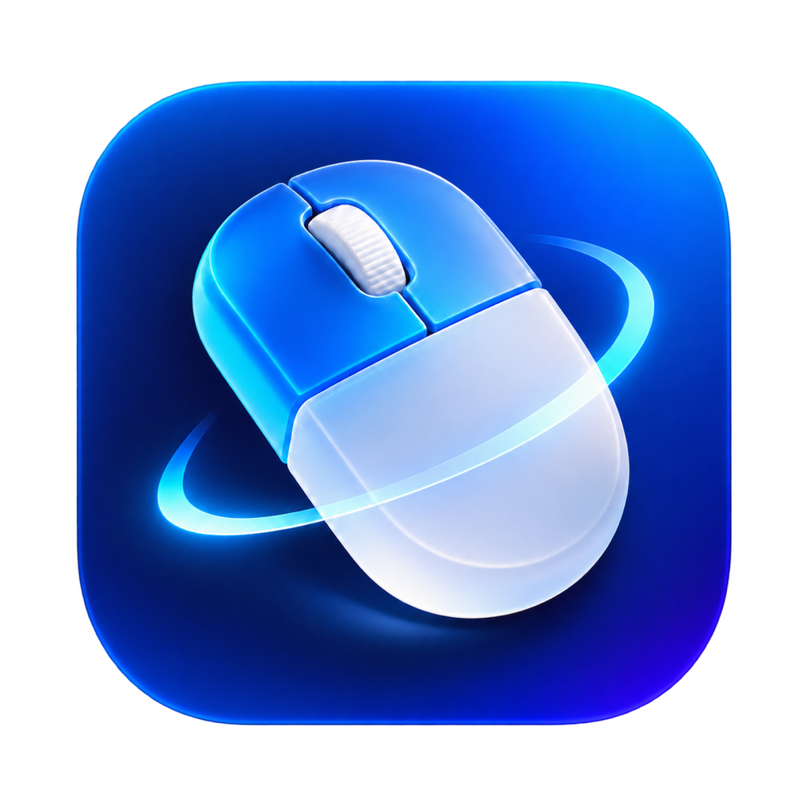

**English** · [简体中文](README_zh-Hans.md)

<div align="center">
  
  <h1>InMouse</h1>
  <p>Mouse gestures for window management and everyday actions on macOS.</p>
  <p>
    <a href="https://github.com/istraw/InMouse/releases/latest">Download InMouse</a> ·
    <a href="https://github.com/istraw/InMouse/issues">Report an issue</a> ·
    <a href="LICENSE">AGPL-3.0 License</a>
  </p>
</div>

**InMouse is a mouse and trackpad gesture tool for macOS.** Hold the right mouse button and draw a gesture to arrange windows, run keyboard shortcuts, open apps, or control media.

You can act on the window under your pointer, including inactive windows, and assign different actions to different apps. InMouse runs from the menu bar, keeps gestures active when Settings is closed, and supports configuration backups and in-app updates.

Built on [Licoy/StrokeMouse](https://github.com/Licoy/StrokeMouse), InMouse extends the original project with additional window controls and menu bar improvements. Development takes place on **`main`**; **`upstream`** preserves and tracks the original project's code.

## Download and install

Requires **macOS 14 or later**. System window arrangements require macOS 15 or later and the focused foreground window.

| Mac | Installer |
| --- | --- |
| Apple Silicon (M series) | [Download arm64 DMG](https://github.com/istraw/InMouse/releases/latest/download/InMouse-macos-arm64.dmg) |
| Intel | [Download x86_64 DMG](https://github.com/istraw/InMouse/releases/latest/download/InMouse-macos-x86_64.dmg) |

Open the DMG and drag **InMouse.app** into **Applications**. On first launch, grant Accessibility permission in System Settings to enable global gestures and window actions.

Current builds are signed with an Apple Development certificate and **have not been notarized by Apple**. If macOS blocks the first launch, allow the app in **System Settings → Privacy & Security**.

After installing, use **Check for Updates** in the app. Installers and update feeds are hosted in this repository, and update archives are signed with a dedicated Sparkle Ed25519 key.

## What you can do

| Task | Actions |
| --- | --- |
| Arrange windows | Half-screen and corner layouts, maximize, center, custom sizes, restore the previous frame, or move to another display |
| Control inactive windows | Point at a window and use a gesture to adjust its frame, minimize it, or close it |
| Reduce repeated keystrokes | Run shortcuts, shortcut sequences, or launch apps |
| Customize by app | Assign app-specific gestures, mouse button mappings, and actions |

## Features

### Window management

- Maximize using the native macOS **Fill** command when available, and restore the window's previous position and size.
- Choose left, right, top, or bottom halves, or any of the four corner quarters.
- Use native two-, three-, or four-window arrangements on macOS 15 or later. These require the focused foreground window and also rearrange other windows; restoring the previous frame restores only the gesture target.
- Set custom **X, Y, width, and height** as percentages of the screen's usable area, with a live preview.
- Find actions by category: basic controls, single-window layouts, multiple-window arrangements, size and display, or application windows and switching.
- Maximize width or height independently, or move a window to the next display.
- Minimize all windows of the target app, or restore one or all of its minimized windows.
- Preserve the original restore point when maximizing repeatedly and account for application size constraints.

[Window behavior and limitations (Chinese)](docs/window-controls.md)

### Act on the window under your pointer

New gestures default to targeting the **application under the pointer**. The target window is captured when you press the trigger button and stays fixed throughout the gesture.

Existing gestures keep their target settings. Window frame actions can operate on inactive windows; keyboard shortcuts first activate the captured target before posting keystrokes. Native system arrangements require the focused foreground window.

### Menu bar operation

- Close Settings to hide the Dock icon while gestures keep running.
- Use the menu bar to reopen Settings, pause gestures, or quit.
- The monochrome menu bar icon adapts to light and dark appearances.
- Adjust Dock and menu bar visibility in General settings.

### In-app updates and backups

Use **Check for Updates** to download releases from this repository. Sparkle verifies update signatures, and [GitHub Releases](https://github.com/istraw/InMouse/releases) also provides installers and release notes.

Gesture configuration remains at the following location for compatibility:

```text
~/Library/Application Support/StrokeMouse/gestures.json
```

Use **Export** in the gesture list to back up your configuration. Configurations containing the new window layout actions use format v10; keep a backup before opening them with older app versions. When switching to the standalone InMouse release from a development build, grant Accessibility permission to the release app.

[Release and update details (Chinese)](docs/inmouse-releases.md)

## Quick start

1. Install and launch InMouse, then grant Accessibility permission.
2. Open Settings from the menu bar and add or edit a gesture.
3. Record a stroke, choose an action, and optionally limit it to specific apps.
4. Point at the target window, hold the trigger button, draw, and release to run the action.

The default trigger is the right mouse button. Middle and side buttons are also supported.

For **Mouse Draw**, hold the chosen mouse button while drawing in the recording canvas. For **Trackpad Draw**, place the pointer in the canvas, hold one supported modifier key (Fn, Control, Option, Shift, or Command), move the pointer with one finger, and release the modifier. You do not need to press down on the trackpad. Experimental multi-finger **Touch Gestures** are a separate input type.

## Action categories

- **Desktop:** Mission Control, Show Desktop, Spaces, Dock, and desktop file visibility.
- **Browser:** navigation, scrolling to the top or bottom, and tab controls.
- **System:** sleep, lock screen, screen saver, appearance, Trash, keeping the Mac awake, and random wallpaper.
- **Finder:** window and folder navigation, common folders, AirDrop, server connections, and setting a picture as wallpaper.
- **Window controls:** layouts, maximize, restore, minimize, and moving between displays.

[Action behavior, targets, and limitations (Chinese)](docs/builtin-actions.md)

## Interface languages

English, 简体中文, 繁體中文, 한국어, 日本語, Русский, and Français.

## More gesture options

InMouse also retains the upstream project's mouse button mappings, mouse combinations, experimental multi-finger gestures, scrolling enhancements, app-specific profiles, import and export, media controls, and Shell / AppleScript actions.

Experimental multi-finger input uses an undocumented Apple touch interface and may be affected by macOS updates. The original project's documentation is preserved in [English](README_upstream.md), [Simplified Chinese](README_upstream_zh-Hans.md), [Traditional Chinese](README_zh-Hant.md), [Korean](README_ko.md), [Japanese](README_ja.md), [Russian](README_ru.md), and [French](README_fr.md). Those documents describe upstream StrokeMouse; use the download links on this page to install InMouse.

## Local development

InMouse uses Swift, SwiftUI, Xcode, and XcodeGen. The Xcode project, app target, and scheme are all named `InMouse`.

```bash
brew install xcodegen
./scripts/generate_project.sh
open InMouse.xcodeproj
```

Build with a local signing identity. The app is written to `output.noindex/InMouse.app`:

```bash
CODE_SIGN_IDENTITY='<your local signing identity>' ./scripts/build.sh --release
```

## Credits and license

Thanks to [Licoy/StrokeMouse](https://github.com/Licoy/StrokeMouse) for the original implementation. InMouse retains the project's [AGPL-3.0 license](LICENSE) and attribution. InMouse changes are maintained on `main`, with upstream code tracked on `upstream`.
