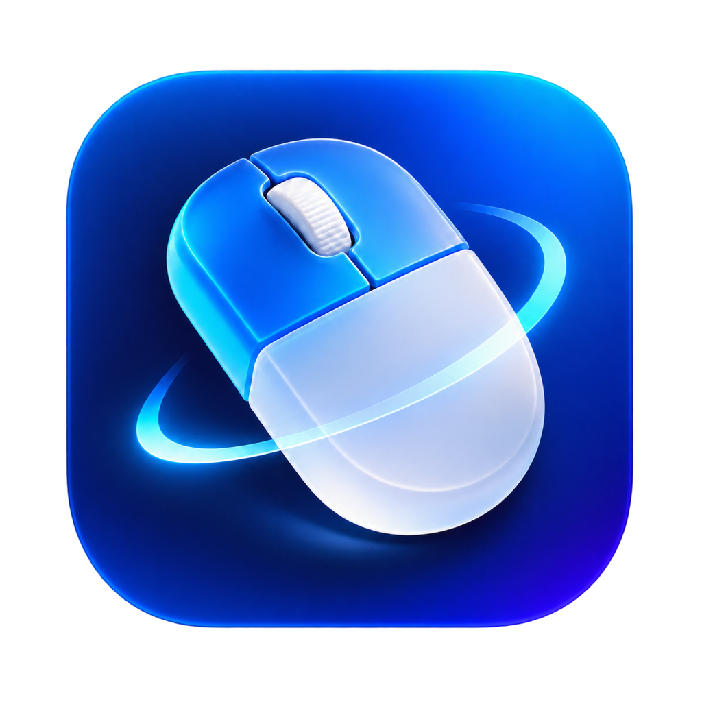

<div align="center">
  
  <h1>InMouse</h1>
  <p>用鼠标手势，完成窗口整理与日常操作。</p>
  <p>
    <a href="https://github.com/istraw/InMouse/releases/latest">下载 InMouse</a> ·
    <a href="https://github.com/istraw/InMouse/issues">反馈问题</a> ·
    <a href="LICENSE">AGPL-3.0 许可证</a>
  </p>
</div>

**InMouse 是一款面向 macOS 的鼠标与触控板手势工具。** 按住鼠标右键绘制轨迹，就能整理窗口、执行快捷键、打开应用或控制媒体，让常用操作集中在鼠标手边。

你可以把鼠标移到未激活的窗口上，直接用手势调整它的位置和大小、最小化或关闭；也可以为不同应用配置不同动作，建立适合自己工作习惯的手势库。InMouse 常驻状态栏，关闭设置后仍在后台运行，并支持配置导入导出和应用内更新。

项目基于 [Licoy/StrokeMouse](https://github.com/Licoy/StrokeMouse) 开发，在原有手势能力上重点扩展窗口控制与状态栏体验。**`main`** 是 InMouse 的主开发和默认展示分支，**`upstream`** 用于保留并同步原作者代码。

## 下载与安装

要求 **macOS 14 或以上**。

| Mac 类型 | 安装包 |
| --- | --- |
| Apple Silicon（M 系列） | [下载 arm64 DMG](https://github.com/istraw/InMouse/releases/latest/download/InMouse-macos-arm64.dmg) |
| Intel | [下载 x86_64 DMG](https://github.com/istraw/InMouse/releases/latest/download/InMouse-macos-x86_64.dmg) |

打开 DMG，将 **InMouse.app** 拖入“应用程序”。首次打开后，在系统设置中授予辅助功能权限，即可使用全局手势和窗口操作。

当前安装包使用 Apple Development 证书签名，**尚未通过 Apple 公证**。若 macOS 拦截首次启动，可在“系统设置 → 隐私与安全性”中允许打开。

已安装正式版后，可在应用内点击 **“检查更新”**。安装包与更新列表来自本仓库，更新档案使用独立的 Sparkle Ed25519 密钥签名。

## 适合哪些操作

| 使用场景 | 可以配置的操作 |
| --- | --- |
| 整理多个窗口 | 左右分屏、居中、自定义尺寸、恢复原布局、移到下一屏幕 |
| 操作后台窗口 | 鼠标移到目标窗口后，用手势调整布局、最小化或关闭 |
| 减少重复按键 | 用手势执行快捷键、连续按键或打开常用应用 |
| 按应用定制习惯 | 为浏览器、编辑器和其他应用分别设置手势与按键映射 |

## 主要功能

### 更完整的窗口控制

- 按屏幕可用区域的百分比自定义窗口 **X、Y、宽度和高度**，支持实时预览。
- 提供左半屏、右半屏、居中 80% 等布局预设。
- 恢复窗口前一个位置和大小，重复最大化不会覆盖原来的恢复记录。
- 单独最大化窗口高度或宽度，移动窗口到下一个显示器。
- 最小化目标应用的全部窗口，恢复一个或全部最小化窗口。
- 处理应用最小尺寸等限制，减少窗口已经调整却报告失败的情况。

[窗口操作的完整行为与限制](docs/window-controls.md)

### 对鼠标下的窗口执行手势

新建手势默认选择 **“指针位置所属应用”**：把鼠标放到非激活窗口上，直接按住右键绘制，即可对该窗口执行动作。目标在按下触发键时锁定，绘制途中移到别处不会改变目标。

已有手势保留原设置，也可在编辑器的“手势目标”中切换。快捷键动作会先激活锁定的目标窗口，再发送快捷键。

### 状态栏驻留

- 关闭设置窗口后隐藏 Dock 图标，应用和手势继续运行。
- 保留状态栏入口，可重新打开设置、暂停手势或退出应用。
- 使用面性单色鼠标图标，自动适配 macOS 明暗背景。
- 可在通用设置中调整 Dock 和状态栏显示偏好。

### 应用内更新

在应用内点击“检查更新”，即可获取本仓库发布的版本。更新档案会经过签名校验，安装包与发布说明也可以在 [Releases 页面](https://github.com/istraw/InMouse/releases)查看。

[发布与更新说明](docs/inmouse-releases.md)

## 快速上手

1. 安装并打开 InMouse，完成辅助功能授权。
2. 从状态栏打开设置，在手势列表中添加或编辑手势。
3. 录制轨迹，选择要执行的窗口操作、快捷键或其他动作，并按需设置应用范围。
4. 将鼠标移到目标窗口上，按住触发键绘制轨迹，松开后执行动作。

默认触发键为鼠标右键，也可以为手势选择中键、侧键或其他支持的输入方式。

录制鼠标绘制样本时，按住右键、中键或侧键拖动画布；录制触控板绘制样本时，将指针放入画布，按住所选修饰键（如 Fn），用单指在触控板上移动，松开修饰键结束，无需按下触控板。触控板绘制使用修饰键与指针轨迹，多指轻点、滑动等则属于独立的“触控手势”。

## 内置动作分类

- **桌面**：调度中心、显示桌面、切换空间、程序坞和桌面文件显示。
- **浏览器**：前进后退、到顶到底、新建／关闭标签页、切换标签页。
- **系统**：电源与锁屏、屏幕保护、外观、废纸篓、保持唤醒及随机壁纸。
- **访达**：窗口与目录导航、常用文件夹、隔空投送、连接服务器和图片设为壁纸。
- **窗口操作**：布局、最大化、恢复、最小化和跨显示器移动。

[动作行为、目标与限制](docs/builtin-actions.md)

## 更多手势能力

继承上游的鼠标绘制、鼠标按键映射、鼠标组合、触控板绘制、实验性多指触控手势、滚动增强、按应用配置、手势导入导出，以及快捷键、打开应用、媒体控制、Shell / AppleScript 等动作。

实验性多指触控使用 Apple 未公开的触控接口，可能受系统更新影响。更多原版能力可参考[上游中文说明](README_zh-Hans.md)和[保留的上游英文说明](README_upstream.md)；这些是原项目文档，安装 InMouse 请使用本页的下载入口。

## 配置与备份

为兼容已有手势，配置文件仍保存在：

```text
~/Library/Application Support/StrokeMouse/gestures.json
```

可在应用的手势列表中点击“导出”备份。切换到 InMouse 的独立正式版后，首次需要重新确认辅助功能授权。

## 本地开发

使用 Swift / SwiftUI、Xcode 和 XcodeGen，工程及 Scheme 名称保留为 `StrokeMouse`。

```bash
brew install xcodegen
./scripts/generate_project.sh
open StrokeMouse.xcodeproj
```

使用本机签名身份构建到 `output/InMouse.app`：

```bash
CODE_SIGN_IDENTITY='<本机签名证书>' ./scripts/build.sh --release
```

## 来源与许可证

感谢 [Licoy/StrokeMouse](https://github.com/Licoy/StrokeMouse) 提供原始实现。InMouse 保留原项目的 [AGPL-3.0 许可证](LICENSE) 和来源信息，InMouse 的功能修改在 `main` 分支维护，上游同步代码保留在 `upstream` 分支。
